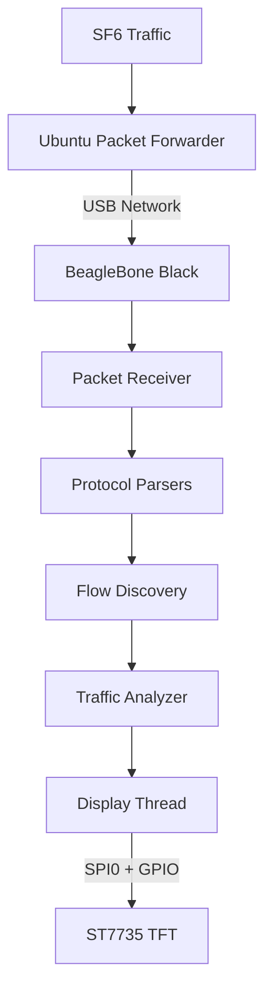
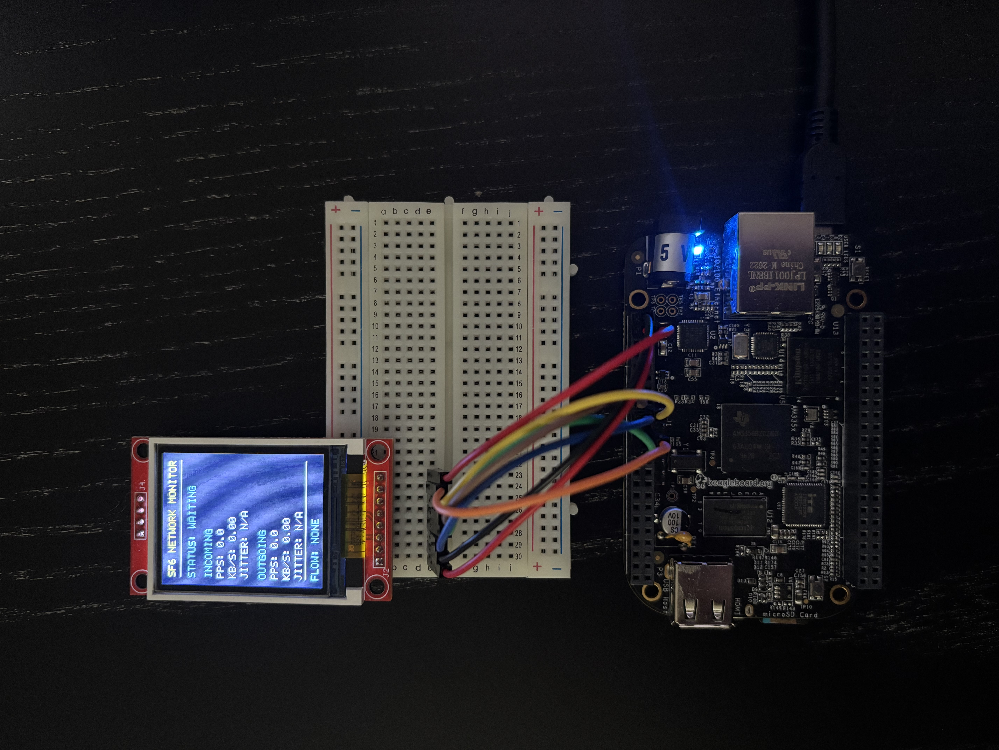
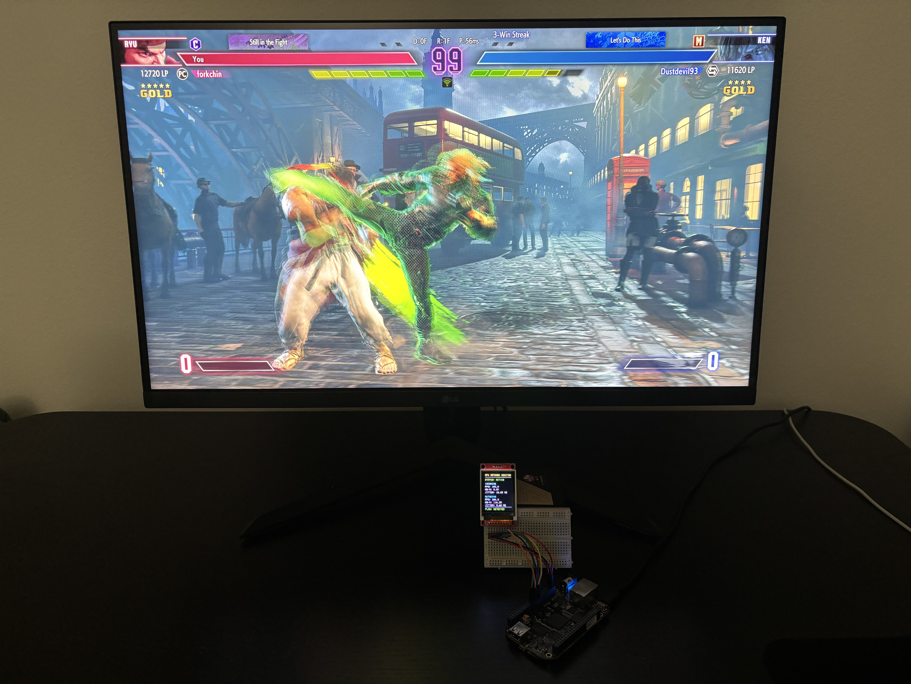
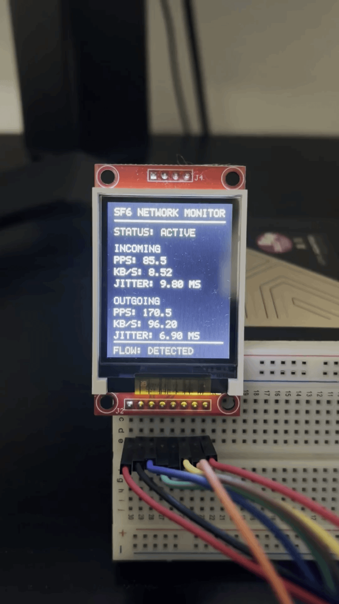

# SF6 Network Telemetry Monitor

A C++ embedded Linux application that monitors Street Fighter 6 UDP traffic during online matches and displays live network statistics on an ST7735 TFT connected to a BeagleBone Black. The application runs on a custom Buildroot Linux image and starts automatically at boot.

## Overview

- Parses Ethernet, IPv4, and UDP packets forwarded from a host machine running Ubuntu.
- Automatically discovers UDP flow from online matches and tracks incoming/outgoing packet rates, throughput, and inter-packet jitter.
- Updates the ST7735 dashboard every 500 ms on a separate thread while retaining five-second terminal reports.
- Uses hardware SPI0 (`/dev/spidev0.0`) and GPIO character devices for display control.

## Repositories

This project consists of three repositories:

- **[sf6-telemetry-monitor]()** — C++ application running on the BeagleBone Black that processes UDP traffic, calculates network statistics, and updates the ST7735 display.
- **[sf6-packet-forwarder]()** — Ubuntu application that captures network traffic and forwards packets to the BBB over USB networking.
- **[sf6-buildroot]()** — Custom Buildroot external tree containing the device tree, package configuration, and automatic startup script.

## Architecture



## Hardware

- BeagleBone Black booting a custom Buildroot Linux image from a microSD card
- 128 × 160 ST7735 TFT display
- Ubuntu host running SF6, connected to the BBB over USB networking

## Pin Configuration

| ST7735 | BBB | Function |
|--------|-----|----------|
| SCK | P9_22 | SPI0 clock |
| SDA/MOSI | P9_18 | SPI0 MOSI |
| CS | P9_17 | SPI0 CS0 |
| DC | P9_15 | `/dev/gpiochip0`, line 16 |
| RST | P9_23 | `/dev/gpiochip0`, line 17 |
| VCC/GND | P9_3/P9_1 | 3.3V/Ground |

## Buildroot Integration

The custom Buildroot external tree includes:

- An SPI0-enabled BeagleBone Black device tree and the required SPI/GPIO kernel support.
- An `sf6-monitor` package that builds the C++ application and installs it at `/usr/bin/sf6-monitor`.
- A post-image script that packages the custom DTB as `am335x-boneblack.dtb`.
- A SysV init script at `/etc/init.d/S99sf6-monitor` that launches the dashboard automatically at boot.

The application, Buildroot external tree (`sf6-buildroot`), and Ubuntu packet forwarder are maintained as separate projects.

## Build and Run

### 1. Build the Application and Linux Image

Configure the Buildroot workspace and external tree, then build the monitor and SD card image:

```bash
cd ~/projects/buildroot
make sf6-monitor-dirclean
make sf6-monitor
make
```

### 2. Flash the SD Card

Flash `output/images/sdcard.img` to the target microSD card, then boot the BBB.

**Warning:** Flashing overwrites the contents of the selected card. Verify the target device before proceeding.

### 3. Run the Monitor

The monitor starts automatically at boot. To manage it manually, connect to the BBB and use:

```bash
/etc/init.d/S99sf6-monitor status
/etc/init.d/S99sf6-monitor stop
/etc/init.d/S99sf6-monitor start
```

Alternatively, run the application directly after stopping the service:

```bash
/usr/bin/sf6-monitor 192.168.0.157
```

Replace the IP address with the local IP address of the machine running SF6.

### 4. Start the Packet Forwarder

On the Ubuntu host running SF6, launch the separate `sf6-packet-forwarder` application (available in a separate GitHub repository) and start an online match:

```bash
cd ~/projects/sf6-packet-forwarder
sudo ./build/sf6-packet-forwarder
```

The ST7735 dashboard automatically updates with live network statistics when a matching UDP flow is detected.

## Demo

<p align="center">
    
    
    
</p>